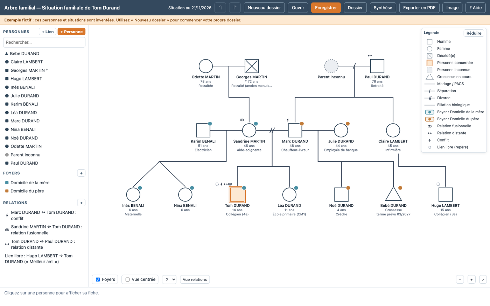
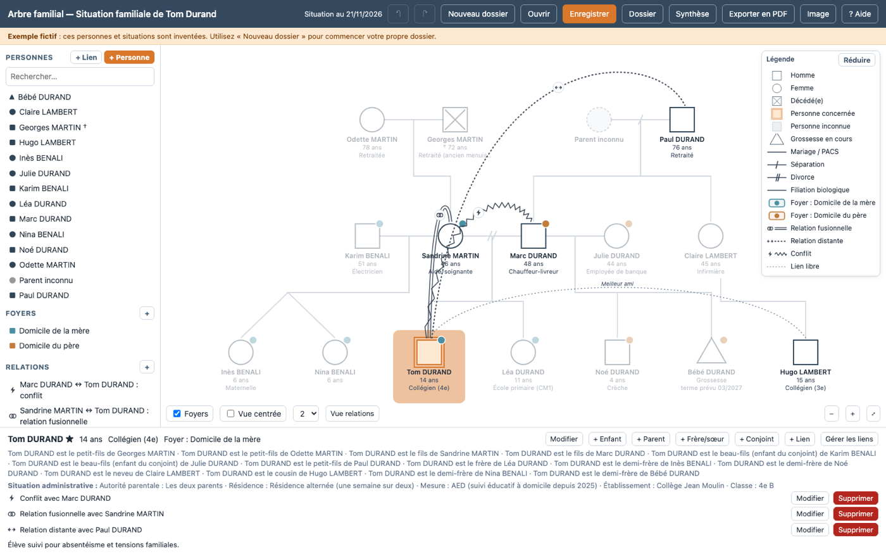
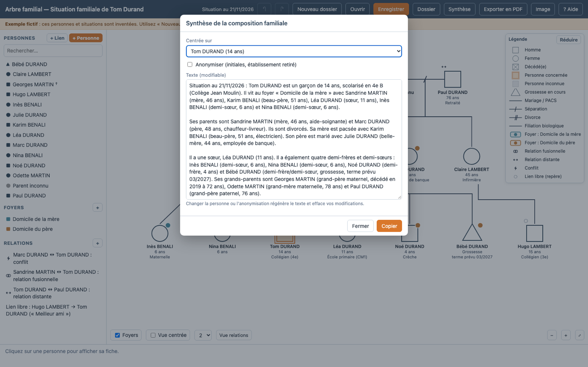
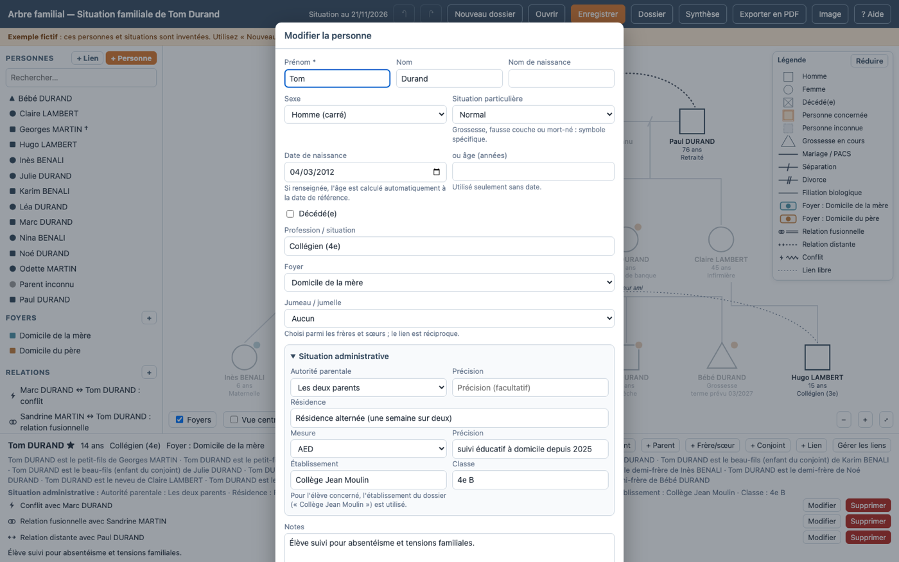

# Arbre généalogique et génogramme

<!-- hub:accroche -->
Dessiner le génogramme d'un élève hors ligne, pour les infirmières scolaires et les assistantes sociales.
<!-- /hub:accroche -->

<p align="center">
  <a href="https://github.com/collet-david-pro/TravailArbreGene/releases/latest/download/arbre-genealogique.html"></a>
</p>

<p align="center">
  
  
  <a href="LICENSE"></a>
</p>



**TravailArbreGene** produit des arbres généalogiques et des génogrammes professionnels, 100 % hors ligne, dans un seul fichier HTML. Il est pensé pour les infirmières scolaires, les assistantes sociales et tous les professionnels de l'accompagnement.

> 🔒 **Aucune donnée ne quitte votre ordinateur.** Pas de compte, pas de serveur, pas de connexion Internet. Un double-clic sur le fichier, et c'est parti.

## Le problème

<!-- hub:probleme -->

Comprendre une situation familiale (divorces, familles recomposées, demi-frères et sœurs, adoption, placement…) prend du temps, et la dessiner à la main en prend encore plus. Les logiciels de généalogie existants sont pensés pour les loisirs, souvent en ligne, et peu compatibles avec des données sensibles de mineurs. Il fallait un outil qui permette de saisir vite avec de simples formulaires en français, de voir tout de suite un génogramme propre qui se met à jour seul, et de produire un document à joindre à un dossier, sans jamais rien envoyer sur Internet.

<!-- /hub:probleme -->

## Fonctionnalités

<!-- hub:fonctionnalites -->

- **Saisie guidée** : une simple phrase, « Léa est la demi-sœur de Tom ». L'outil pose les bonnes questions et crée les parents inconnus si besoin.
- **Arbre automatique** : disposition par générations, frères et sœurs classés par âge, familles recomposées lisibles, jumeaux, grossesse, fausse couche.
- **Familles pluriparentales** : parents biologiques, adoptifs, d'accueil, parent qui n'a pas reconnu l'enfant, et groupes de trois parents ou plus pour une même fratrie.
- **Édition dans l'arbre** : un clic sur un trait permet de changer le type du lien ou de le supprimer.
- **Situation administrative** : autorité parentale, résidence, mesure en cours (AED, AEMO, placement…), établissement et classe.
- **Foyers et relations** : qui vit avec qui, en couleur ; relations (proche, conflit, rupture, violence…) en icônes.
- **Vue centrée** : pour les grandes familles, seules les personnes proches de l'élève restent affichées.
- **Documents** : PDF A4 ou A3 avec logo et légende, image PNG ou SVG, synthèse texte prête à copier dans un rapport.
- **Anonymisation** : initiales à la place des noms ; notes, établissement et logo retirés.
- **Confidentialité** : aucune connexion, aucun stockage dans le navigateur ; chaque famille est un fichier que vous gardez.

<!-- /hub:fonctionnalites -->

## Stack technique

<!-- hub:stack -->

- **Un seul fichier HTML** : toute l'application (pages, styles, code), à ouvrir par double-clic, sans installation.
- **JavaScript sans bibliothèque** : le moteur de parenté, la disposition de l'arbre et la synthèse, sans framework ni dépendance.
- **SVG** : le dessin de l'arbre, net à toutes les tailles ; export PNG par canvas.
- **Impression du navigateur** : la mise en page PDF (`@media print`, `@page`).
- **Fichiers JSON** : un fichier par famille, lisible et documenté.
- **Content-Security-Policy** : une règle intégrée au fichier qui interdit au navigateur toute connexion sortante.

<!-- /hub:stack -->

## Fait avec l'IA

<!-- hub:ia -->

Conçu et codé par Claude, l'assistant d'Anthropic, utilisé via Claude Code. David Collet a défini le besoin avec des professionnelles de terrain (une infirmière scolaire et une assistante sociale), puis testé et validé chaque fonctionnalité. L'IA n'intervient qu'à la conception : l'application elle-même n'utilise aucune IA et ne se connecte à aucun service.

<!-- /hub:ia -->

## Installation

<!-- hub:installation -->

Aucune installation : l'outil est un simple fichier HTML.

1. Téléchargez [arbre-genealogique.html](https://github.com/collet-david-pro/TravailArbreGene/releases/latest/download/arbre-genealogique.html) depuis la dernière version publiée.
2. Ouvrez-le par double-clic dans Firefox ou Chrome.
3. Cliquez sur **« Charger l'exemple »** pour découvrir l'outil, ou sur **« Voir le tutoriel »**.
4. Pour un vrai dossier : **Nouveau dossier**, puis renseignez **Dossier** (titre, établissement, logo, date de référence).
5. Ajoutez la personne concernée, puis sa famille avec les boutons **+ Parent**, **+ Frère/sœur**…
6. **Enregistrez** le fichier `.json`, puis exportez en **PDF**, en **Image** ou en **Synthèse**.

> **Attention :** il n'y a pas de sauvegarde automatique. C'est voulu, pour ne rien laisser dans le navigateur. Un indicateur « non enregistré » s'affiche, et le navigateur vous prévient si vous fermez la page sans avoir enregistré.

<!-- /hub:installation -->

## Captures d'écran

*Toutes les données affichées sont fictives.*



**Clic sur une personne** : ses relations apparaissent en arcs avec leur icône, et sa fiche s'affiche en bas.



**Synthèse** : un texte rédigé automatiquement, à copier dans un rapport.



**Fiche personne** avec la situation administrative.

## Fonctionnalités en détail

### Saisie

| | |
|---|---|
| 👤 **Fiches personnes** | Prénom, nom, nom de naissance, sexe, date de naissance (âge calculé automatiquement) ou âge, profession, décès, notes. |
| 🔗 **Liens guidés** | Une simple phrase : « X est le/la … de Y ». L'outil pose les bonnes questions (« Qui est l'autre parent ? », « Par quel parent ? ») et crée les parents inconnus si besoin. |
| ⚡ **Boutons rapides** | Depuis la fiche d'une personne : **+ Enfant**, **+ Parent**, **+ Frère/sœur**, **+ Conjoint**, **Groupe parental**. |
| 👨‍👩‍👧 **Familles pluriparentales** | Un enfant peut avoir ses parents biologiques **et** ses parents adoptifs (ou d'accueil). Le lien **« biologique, sans reconnaissance »** couvre le parent qui n'a pas reconnu l'enfant (2 pères et 2 mères possibles, par exemple). |
| 🤝 **Groupe parental** | Trois parents ou plus pour une même fratrie (par exemple deux parents biologiques et un parent adoptif) : ils sont placés côte à côte et reliés par une accolade d'où partent les traits vers les enfants. |
| 🖱️ **Édition dans l'arbre** | Un clic sur un trait permet de changer le type du lien ou de le **supprimer** (avec confirmation). Un clic sur une accolade ouvre le groupe parental. |
| 🔄 **Parent inconnu remplaçable** | Le jour où vous savez qui c'est, remplacez le « Parent inconnu » par une personne déjà saisie : tous les liens sont reportés. |
| ↶ **Annuler / Rétablir** | <kbd>Ctrl</kbd>+<kbd>Z</kbd> / <kbd>Ctrl</kbd>+<kbd>Y</kbd> (<kbd>Cmd</kbd>+<kbd>Z</kbd> sur Mac), 50 niveaux. |
| ✅ **Contrôles de cohérence** | Alertes en cas d'âge incohérent, de plus de deux parents biologiques ou de boucle impossible dans l'arbre. |

### Contenu métier

| | |
|---|---|
| ⭐ **Personne concernée** | L'élève ou l'usager suivi est mis en évidence. |
| 📋 **Situation administrative** | Autorité parentale, résidence, mesure en cours (AED, AEMO, placement ASE ou judiciaire, tutelle), établissement et classe. |
| 📅 **Date de référence** | Tous les âges sont calculés « au JJ/MM/AAAA ». Un dossier rouvert un an plus tard reste cohérent. |
| 🏠 **Foyers** | Qui vit avec qui (domicile de la mère, famille d'accueil…), repéré par couleur. |
| 💬 **Relations** | Proche, fusionnelle, distante, conflit, rupture, violence, emprise. Chacune a son **icône** et s'affiche à la demande, sans surcharger l'arbre. |
| 👶 **Symboles complets** | Grossesse en cours, fausse couche, enfant mort-né, **jumeaux**. |

### Affichage

| | |
|---|---|
| 🌳 **Arbre automatique** | Disposition par générations. Les frères et sœurs sont classés par âge (aîné à gauche), chaque couple a sa propre ligne, et les familles recomposées sont lisibles. Aucun trait d'union ne passe derrière une autre personne. |
| 🧭 **Placement d'un enfant à plusieurs familles** | Tous les traits restent dessinés, chacun avec son style. Vous choisissez sous quels parents l'enfant est placé : automatique (parents adoptifs s'il y en a), biologiques, adoptifs, famille d'accueil, beaux-parents ou entre tous. |
| 🗺️ **Légende intégrée** | Un cartouche sur l'arbre ne liste que les symboles réellement utilisés. |
| 🎯 **Vue centrée** | Pour les grandes familles : seules les personnes proches de l'élève restent affichées (profondeur 1 à 4). |
| 🔍 **Zoom et déplacement** | Molette ou boutons + / − / recentrer. |
| ❓ **Tutoriel intégré** | Une aide pas à pas et un **exemple fictif** pour s'entraîner. |

### Documents

| | |
|---|---|
| 📄 **PDF** | A4 ou A3, en-tête avec logo et nom de l'établissement, légende sur l'arbre et en fin de document. En option : tableau détaillé des personnes et version anonymisée. |
| 🖼️ **Image** | Export PNG ou SVG de l'arbre, pour l'insérer dans Word ou dans un rapport. |
| 📝 **Synthèse texte** | Un paragraphe rédigé qui décrit la composition familiale, prêt à copier-coller dans un écrit professionnel. Il peut être anonymisé. |

## Lire l'arbre : symboles et icônes

L'outil suit les conventions du **génogramme**.

| Symbole | Signification | | Trait | Signification |
|---|---|---|---|---|
| ■ carré | Homme | | ── plein | Mariage / PACS, filiation biologique |
| ● cercle | Femme | | ╌╌ tireté | Concubinage, adoption |
| ◆ losange | Sexe non précisé | | ┈┈ pointillé | Accueil / placement |
| ☒ croix | Personne décédée | | ─·· tiret-point-point | Parent biologique sans reconnaissance |
| ▲ triangle | Grossesse en cours | | ─/─ | Séparation |
| • petit cercle plein | Fausse couche | | ─//─ | Divorce |
| contour orange | Personne concernée | | ⋀ traits joints | Jumeaux |
| grisé pointillé | Personne inconnue | | ⎵ accolade | Groupe parental (coparents) |

**Relations** : ♥ proche · ⚭ fusionnelle · ↔ distante · ⚡ conflit · ✂ rupture · ⚠ violence · 🔒 emprise.
Les icônes apparaissent à côté des personnes concernées. Un clic sur une personne affiche ses relations en arcs ; le bouton **Vue relations** les montre toutes.

## Liens de parenté

Père / mère · fils / fille · frère / sœur · demi-frère / demi-sœur · frère / sœur par alliance · conjoint(e) · ex-conjoint(e) · grand-parent · petit-enfant · oncle / tante · neveu / nièce · cousin(e) · beau-père / belle-mère · beau-frère / belle-sœur · gendre / belle-fille · enfant adopté / placé · père / mère biologique sans reconnaissance · coparent · **lien libre** (parrain, référent, meilleur ami…).

Les liens sont **calculés**, jamais saisis deux fois. Exemple : si « Léa est la sœur de Tom », la fiche de Tom indique automatiquement « Tom est le frère de Léa ». Deux enfants qui ont les mêmes parents sont « frère et sœur » ; un seul parent en commun, et l'outil indique « demi-frère / demi-sœur ».

## Documents produits : PDF, image, synthèse

**PDF** (bouton *Exporter en PDF*, puis « Enregistrer au format PDF » dans la fenêtre d'impression) :

- format A4 ou A3 paysage ; l'outil suggère l'A3 pour les grandes familles ;
- en-tête avec logo, nom de l'établissement, titre, date de référence et auteur ;
- légende dessinée sur l'arbre, plus une légende complète en fin de document ;
- en option : tableau des personnes (avec la situation administrative), tableau des relations, version anonymisée ;
- pied de page *Document confidentiel, données à caractère personnel* ;
- PDF vectoriel, net à toutes les tailles.

**Image** : PNG (haute définition) ou SVG, avec la légende, et anonymisation possible.

**Synthèse** : un texte rédigé, centré sur l'élève. Il donne sa scolarité, son foyer, ses parents et leur situation de couple, ses beaux-parents, sa fratrie (frères et sœurs, demi-frères et demi-sœurs), ses grands-parents, l'autorité parentale, sa résidence, la mesure en cours et ses relations significatives. Le texte reste modifiable avant d'être copié.

**Anonymisation** : les noms sont remplacés par des initiales. Les notes, le nom de l'établissement, le logo, le nom des foyers et les précisions libres sont retirés.

## Sauvegarde et partage

- **Enregistrer** télécharge un fichier `famille-NOM-AAAA-MM-JJ.json`. Rangez-le dans votre espace professionnel.
- **Ouvrir** recharge un fichier enregistré.
- **Partager** un dossier avec un ou une collègue revient à lui transmettre ce fichier par les canaux internes habituels.

Le format JSON est lisible et documenté : vos données ne sont jamais prisonnières de l'outil.

## Confidentialité et RGPD

- **100 % local** : une politique de sécurité (*Content-Security-Policy*) intégrée au fichier **interdit au navigateur toute connexion sortante**, ce qui se vérifie facilement.
- **Aucun stockage caché** : ni cookie, ni `localStorage`, ni base de données du navigateur. Les données n'existent que dans la page ouverte et dans les fichiers que vous enregistrez vous-même.
- **Aucun traçage**, aucune statistique, aucune police ou bibliothèque téléchargée.
- **Anonymisation** des documents transmis à des tiers.

> La responsabilité du stockage des fichiers `.json` et des documents produits revient à l'utilisateur et à sa structure.

## Compatibilité

| Navigateur | Statut |
|---|---|
| Firefox (récent) | ✅ testé |
| Chrome / Chromium (récent) | ✅ testé |
| Edge, Safari | non testés, probablement fonctionnels |

Le numéro de page du PDF n'apparaît que dans Chrome.

## Pour les développeurs

- **Un seul fichier** : HTML + CSS + JavaScript vanilla, sans framework, sans dépendance et sans étape de compilation.
- **Dessin** en SVG ; mise en page PDF via `@media print` et `@page` ; export PNG par canvas.
- **Logique pure** (modèle, moteur de parenté, disposition, synthèse) isolée entre `/* @core-start */` et `/* @core-end */`. Elle est exposée par l'objet `Core`, testable dans Node.
- **Modèle de données** : `dossier`, `personnes`, `unions`, `filiations`, `groupes` (groupes parentaux), `foyers`, `relations`, `liensLibres`. Types de filiation : `biologique`, `biologique-nr` (sans reconnaissance), `adoptif`, `accueil`, `beau-parent` ; champ `rattachement` d'une personne pour son placement. Les liens « métier » (frère, cousin…) ne sont jamais stockés : ils sont recalculés.

```text
arbre-genealogique.html   application complète
exemple-famille.json      dossier fictif de démonstration
hub.json                  fiche du projet pour davidcollet.fr/hub
docs/                     logo, bannière et captures d'écran
```

## Licence

Ce projet est distribué sous **licence [MIT](LICENSE)**, libre et open source. Vous pouvez l'utiliser, le copier, le modifier, le partager et le redistribuer, y compris dans votre structure ou à des fins commerciales. La seule condition est de conserver la mention de copyright et le texte de la licence.

Le logiciel est fourni « tel quel », sans garantie.
